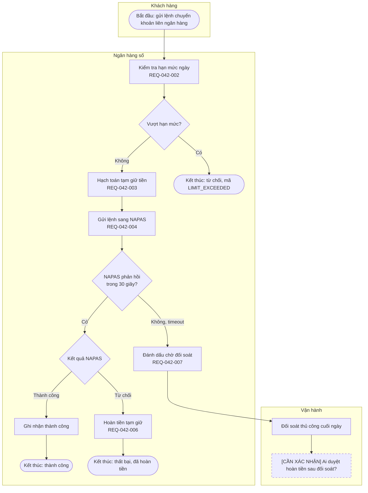
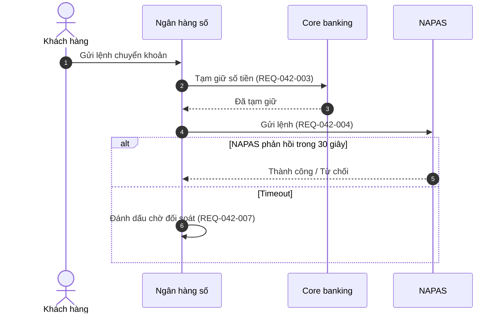

# Sơ đồ luồng nghiệp vụ (Mermaid)

Mermaid là văn bản, nằm ngay trong file `.md`: Claude Code, Kiro, GitHub, GitLab, Confluence (có app Mermaid) đều hiển thị được, và sửa được bằng diff như phần còn lại của BRD.

## Chọn loại sơ đồ

| Cần thể hiện | Dùng |
|---|---|
| Ai làm bước nào, nhánh quyết định, ngoại lệ | `flowchart TD` chia làn bằng `subgraph` theo vai / hệ thống |
| Thứ tự gọi giữa các hệ thống, timeout, phản hồi | `sequenceDiagram` |
| Vòng đời trạng thái hồ sơ / giao dịch | `stateDiagram-v2` |

Luồng dài → tách thành sơ đồ tổng quan (5–10 bước) và sơ đồ chi tiết cho từng bước phức tạp, thay vì một sơ đồ 40 nút.

## Mẫu flowchart

## Mẫu sequence diagram

## Luật vẽ

| Luật | Kiểm thế nào |
|---|---|
| Không bịa bước | Mỗi bước có trong nguồn hoặc BRD. Bước suy ra mà chưa ai xác nhận → nút có nhãn `[CẦN XÁC NHẬN]` và class `pending` (viền nét đứt) |
| Gắn REQ | Bước ứng với yêu cầu thì ghi `REQ-xxx` trong nhãn (` ` để xuống dòng) |
| Quyết định đủ nhánh | Mọi nút `{…}` có nhãn trên **mọi** nhánh ra, và các nhánh phủ hết trường hợp (Có / Không, Thành công / Từ chối / Timeout) |
| Mọi đường đều kết thúc | Mỗi nhánh đi tới một nút kết thúc `(["Kết thúc: …"])` nêu rõ kết quả, hoặc quay về một bước đã có. Không để nhánh treo |
| Hệ thống ngoài có nhánh lỗi | Mỗi lần gọi hệ thống ngoài / core / đối tác có nhánh timeout hoặc lỗi |
| Chạm tiền | Có nhánh hoàn tiền / đảo giao dịch và điểm đối soát |
| Phê duyệt | Bước duyệt (maker–checker) có nhánh *Từ chối* và nói đi đâu sau khi từ chối |
| Không quyết giải pháp | Tên hệ thống chỉ dùng khi nguồn đã nói (NAPAS, core). Không thêm queue, database, microservice |
| Cú pháp an toàn | Nhãn luôn đặt trong ngoặc kép `"…"`; không dùng ký tự `"` bên trong nhãn; id nút chỉ chữ / số không dấu |

## Tự kiểm và nộp

Trước khi nộp, đi lại từng nhánh từ nút *Bắt đầu* và chấm:

- [ ] Mọi nút quyết định có đủ nhánh và nhãn nhánh.
- [ ] Mọi nhánh kết thúc ở nút *Kết thúc* có kết quả rõ.
- [ ] Mỗi lần gọi hệ thống ngoài có nhánh lỗi / timeout.
- [ ] Luồng chạm tiền có hoàn tiền / đảo và đối soát.
- [ ] Bước duyệt có nhánh từ chối.
- [ ] Không có bước nào không truy được về nguồn mà thiếu nhãn `[CẦN XÁC NHẬN]`.

Ô nào chưa đạt → nêu trong khối cảnh báo sau sơ đồ (mẫu của skill `write-brd`), kèm câu hỏi để điền.

Báo người dùng 3 dòng: số bước và số nhánh ngoại lệ · số nút `[CẦN XÁC NHẬN]` · REQ trong BRD chưa xuất hiện trên sơ đồ (nếu vẽ từ BRD).

Vị trí: sơ đồ cho BRD đặt trong mục *Luồng nghiệp vụ & ngoại lệ* của chính BRD; sơ đồ độc lập (as-is / to-be) ghi `flows/<epic>-<slug>.md` hoặc theo quy ước dự án. Người dùng chỉ nhờ vẽ thì trả sơ đồ, không tự chèn vào BRD.
